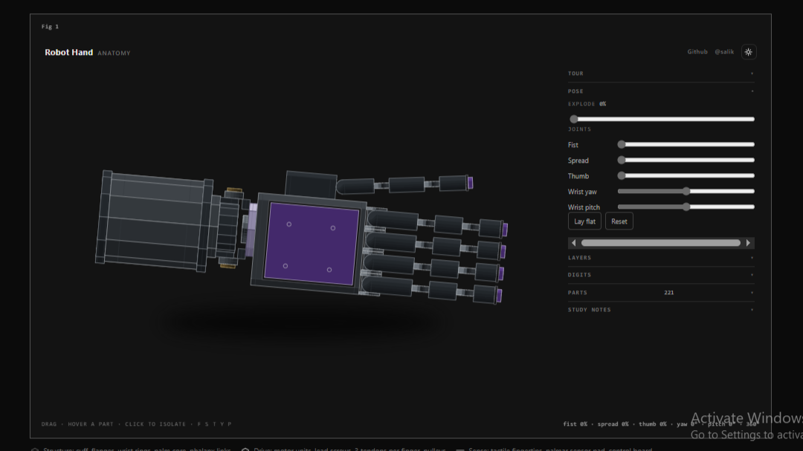
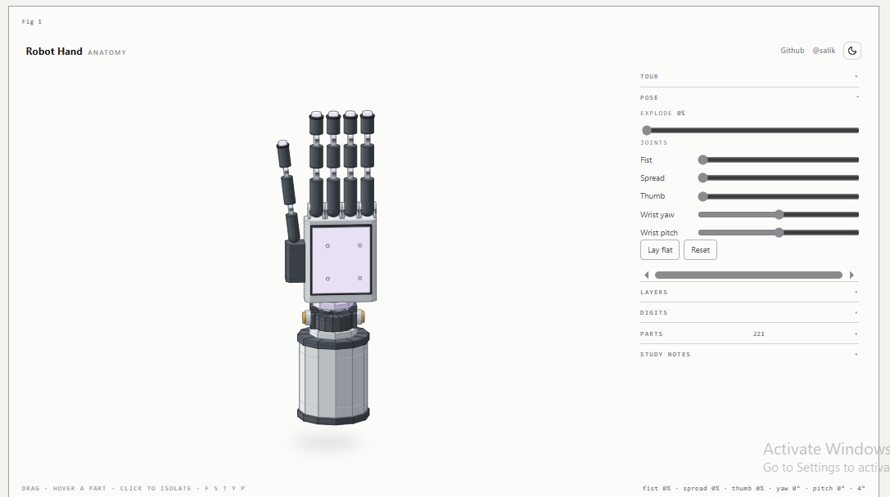

# 22-DOF Tendon-Driven Humanoid Robot Hand · Anatomy & Kinematics Engine

[](LICENSE)
[](#the-rendering-engine)
[](#kinematic-architecture)
[](#quickstart)

> An open-source proof of concept for robotics builders, mechanics students, and graphics engineers: **a complete 22-degree-of-freedom tendon-driven humanoid robot hand running in real-time right inside your browser**—with zero WebGL, zero Three.js, and zero cloud dependencies.

Built as an open interactive laboratory to explore what is possible today on your personal computer: combining real humanoid mechanical engineering with the pure SVG separating-planes rendering engine inspired by [wheresryan22/anatomy](https://github.com/wheresryan22/anatomy).

<p align="center">
  
</p>

<p align="center">
  <em>22-DOF Tendon-Driven Humanoid Robot Hand · Real-Time Pure SVG Anatomy Engine</em>
</p>

---

## Interactive Walkthrough & Demo Video

### 📹 Full Interactive Demonstration (2m 06s)

<video src="https://github.com/salikshah/robot-hand-anatomy/raw/master/robot%20hand%20_%20video.mp4" controls="controls" width="100%"></video>

> 💡 *If the video above does not autoplay in your browser, **[click the screenshot below to watch or download `robot hand _ video.mp4`](robot%20hand%20_%20video.mp4)**:*

[](robot%20hand%20_%20video.mp4)

<p align="center">
  
  
</p>
<p align="center">
  <em>Left: Dark Studio Mode · Right: Classical Day Blueprint Mode</em>
</p>

---

## Why We Built This

Modern humanoid robotics (Tesla Optimus Gen 3, Sanctuary AI Phoenix, CMU LEAP Hand) relies on complex tendon-driven architectures to keep heavy motor packs in the forearm while delivering lightweight, dexterous fingertips. Yet for most learners and builders, these mechanisms remain locked behind proprietary CAD files, paywalled research papers, or heavy simulator stacks (Isaac Sim, MuJoCo) that require dedicated GPUs.

We wanted to build an **open, transparent, zero-install educational laboratory** that anyone can open on any laptop:
- **Inspect every part:** 221 convex solids modeled in real millimeters.
- **Understand the kinematics:** coupled finger curl, thumb opposition sweep, spread abduction, and a 2-axis constant-length wrist transition.
- **Disassemble visually:** smooth exploded views solved mathematically so parts never collide.
- **Pure local computation:** runs 100% offline in client-side SVG and JavaScript.

---

## Engineering Specifications

The model reflects current state-of-the-art dexterous humanoid hand engineering (WIPO patent disclosures and open-source benchmarks):

| Specification | Value | Mechanical Rationale |
|---|---|---|
| **Degrees of Freedom (DOF)** | **22** | 4 DOF per finger × 5 digits + 2 DOF at the wrist |
| **Actuation** | **25 motors** | 25 motor units arranged in concentric rings inside the forearm cuff |
| **Tendon Routing** | **3 cables / finger** | 1 flexor curling coupled PIP/DIP joints + 2 lateral cables controlling abduction/adduction |
| **Wrist Mechanism** | **2-Axis Gimbal** | Pitch ring + yaw ring; cable guide flattens tendons into a vertical stack at the rotation center to keep cable length invariant during wrist rotation |
| **Joint Type** | **Rolling Contact** | Phalanges roll along curved surfaces rather than pivoting on fixed pins, mimicking human joint biomechanics |
| **Tactile Skin** | **5 tips + palm** | Compliant elastomer tactile sensor pad on the palm + 5 fingertip sensor domes |
| **Solids & Parts** | **221 convex parts** | Every bracket, motor unit, lead screw, roller, pulley, and phalanx is an independent solid |
| **Sub-Assemblies** | **71 assemblies** | Explodes along true mechanical disassembly vectors |

---

## Key Interactive Features

### 1. Coupled Tendon Kinematics
- **Fist Curl:** Fingers close on true tendon coupling ratios (DIP curls proportionally with PIP), while the thumb base sweeps $38^\circ$ across the palm and folds tightly across the fingers.
- **Finger Spread:** $26^\circ$ true abduction/adduction fan across the MCP knuckles.
- **Thumb Opposition:** Saddle joint base sweep ($\text{t.o}_1$) and tilt ($\text{t.o}_2$) allows the thumb to meet every fingertip.
- **2-Axis Wrist:** $-50^\circ \dots +50^\circ$ yaw and $-45^\circ \dots +45^\circ$ pitch without tendon slackening.

### 2. Disassembly & Sub-Assembly Isolation
- **Continuous Explode (0–100%):** Drag the explode slider to watch fingertips lead, phalanges fan apart, knuckle guards slide laterally, palm covers lift, and the 25-motor drive pack drop out of the forearm cuff.
- **Layer Filtering:** Toggle **Structure** (steel cuff, titanium core, phalanx links), **Drive Train** (motors, lead screws, cables, pulleys), and **Sense** (tactile pads, dorsal PCB controller).
- **Digit Isolation:** Isolate the Index, Middle, Ring, Little, or Thumb to inspect its tendon channels in isolation.

### 3. Part Inspector (221 Parts)
- Real-time search and filter across all 221 parts.
- Hovering any part highlights it in the 3D model and surfaces an instant technical tooltip with assembly context.
- Clicking any part isolates it on screen.

### 4. Guided Educational Tour & Audio Narration
- Built-in 12-step guided interactive walkthrough explaining the forearm actuators, wrist gimbal, rolling knuckle geometry, and tactile sensors.
- Optional client-side voice narration recorded with Kokoro TTS.

---

## The Rendering Engine: Pure SVG via Separating Planes

This project runs **without WebGL, WebGPU, or 3D canvas libraries**.

Every frame:
1. All 221 convex solids are transformed according to the active joint angles and explode travel.
2. 3D geometry is projected onto an isometric camera plane.
3. The global painting order is resolved dynamically using a **separating-planes topological sort**: for each pair of convex shapes, a linear separator plane determines which solid occludes the other from the camera's viewpoint.
4. Convex polygons are shaded into 4 discrete tone steps (lit, mid, lo, faint) and emitted directly into SVG `<path>` elements.

This eliminates z-fighting, sorting artifacts, and GPU overhead while keeping every part as an inspectable, vector SVG element with crisp edges at any screen resolution.

---

## Quickstart

### Prerequisites
- Node.js 18+
- Modern desktop browser (Chrome, Edge, Firefox, Safari)

### Installation & Run

```bash
# Clone the repository
git clone https://github.com/salikshah/robot-hand-anatomy.git
cd robot-hand-anatomy

# Install lightweight dev dependencies (puppeteer-core for verification)
npm install

# Build both dark and light interactive pages
npm run figure

# Open the interactive laboratory in your default browser
# Windows:
start object/figure.html

# macOS:
open object/figure.html

# Linux:
xdg-open object/figure.html
```

### Keyboard Shortcuts

When the 3D figure has focus, use keyboard shortcuts to drive motion:

| Key | Action |
|---|---|
| `←` / `→` | Orbit yaw left / right ($15^\circ$ step) |
| `↑` / `↓` | Pitch camera up / down ($10^\circ$ step) |
| `Space` or `A` | Toggle Explode (disassemble / assemble) |
| `F` | Close / open fist |
| `S` | Spread / close fingers |
| `T` | Oppose / rest thumb |
| `Y` | Step wrist yaw ($15^\circ$) |
| `P` | Step wrist pitch ($15^\circ$) |
| `Esc` | Reset camera & pose to default |

---

## Project Structure

```
├── audio/               # Narration WAV files for the 12-step tour
├── kit/                 # Isometric projection, separating-plane solver, audit engine
│   ├── iso-kit.mjs      # SVG projection & plate templates
│   ├── turn.mjs         # Kinematic joint transform tree
│   └── audit.mjs        # Geometric clearance & ground support assertions
├── object/              # 3D robot hand definition & interactive runtime
│   ├── build.mjs        # Static HTML builder (compiles dark & light pages)
│   ├── geometry.mjs     # 221 convex solids, hinges, assemblies, anchor definitions
│   ├── film.mjs         # Kinematic coupling equations & travel limits
│   ├── study.mjs        # Tour steps, specifications, part taxonomy metadata
│   ├── live.js          # Interactive browser runtime (orbit, sliders, filters, tour)
│   ├── diagrams/        # High-resolution architectural sub-assembly drawings
│   └── figure.html      # Compiled standalone interactive laboratory
├── launch-assets/       # Creator launch assets, threads, and show HN guides
├── SPEC.md              # Technical engineering specification & patent cross-references
└── package.json
```

---

## Acknowledgments & Pedigree

- **[wheresryan22/anatomy](https://github.com/wheresryan22/anatomy)**: Pioneer of the pure SVG separating-planes mechanical anatomy engine.
- **Tesla Optimus Mechanical Architecture**: Public patent disclosures for 22-DOF tendon routing and wrist gimbal packaging.
- **CMU LEAP Hand**: Open-source inspiration for accessible dexterous robot research.

---

## License

[MIT](LICENSE) © 2026 Salik Shah. Built for learners, researchers, and robotics builders everywhere.
